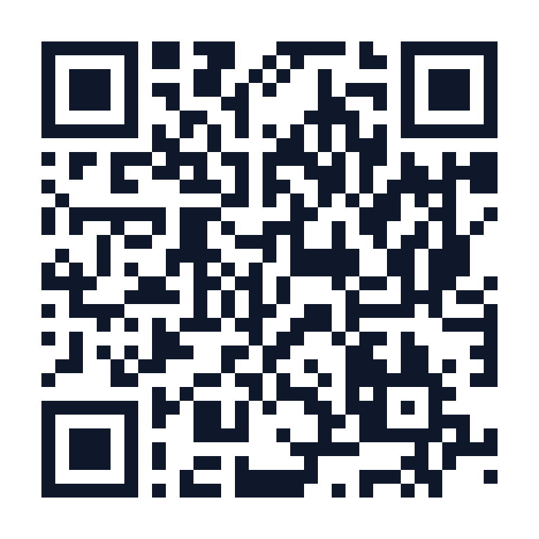

# PhysioMotion Lab

מעבדה קלינית לניתוח תנועה ונוירולוגיה, לסטודנטים לרפואה ולסיעוד. האפליקציה משתמשת במד התאוצה של הטלפון (DeviceMotionEvent) כדי למדוד:

- **בדיקת יציבות (טורקיז):** מבחן רומברג (עיניים פקוחות מול עיניים עצומות, טנדם, שכרות, לאחר מאמץ). מדדים: נדנוד RMS, תאוצת שיא, אורך מסלול ומהירות נדנוד, יחס רומברג.
- **בדיקת רעד ביד (סגול):** רעד מנוחה פרקינסוני (3–6 Hz) מול רעד פיזיולוגי (8–12 Hz). מדדים: משרעת שיא, תדר דומיננטי, חלוקת הספק לרצועות, ציון חומרה.

בכל בדיקה מודדים פעמיים: מדידה 1 (בסיס) ומדידה 2 (אתגור). כוללת השוואה בגרף, טבלת מדדים, רשומות קליניות וייצוא דוח PDF בעברית.

## קישור לטלפון

**https://shulykotzer.github.io/PhysioMotion-Lab/**

סרקו את הקוד במצלמת הטלפון:

## הפעלה

כל האפליקציה היא קובץ אחד: `index.html`.

- **בטלפון:** יש לפתוח את הדף מכתובת **https** (למשל GitHub Pages). בלי https הדפדפן חוסם את חיישני התנועה.
- **במחשב:** אפשר לפתוח את הקובץ ישירות ולהפעיל "נתוני דמה" או "דוגמה מוכנה".

האפליקציה מובילה את הסטודנטים בחמישה שלבים ממוספרים: הפעלת החיישן, בחירת בדיקה, שתי מדידות, תוצאות ודוח.

## הבהרה

סימולטור לימודי לתרגול חשיבה קלינית. אינו מכשיר רפואי ואין להשתמש בו לאבחון.
